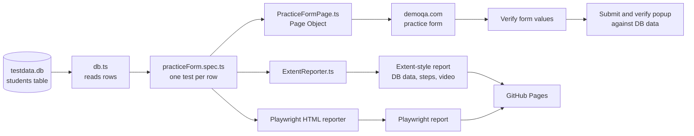

# DemoQA Form - Playwright + TypeScript (POM)

Structure:
```
src/pages/         BasePage, PracticeFormPage  (Page Object Model)
src/utils/         db.ts (SQLite reader), dateUtils.ts
src/reporters/     ExtentReporter.ts (Extent-style HTML report)
scripts/seedDb.ts  testdata.db + sample picture banata hai
tests/             practiceForm.spec.ts (data-driven)
```

Run:
```
npm install
npx playwright install chromium
npm run seed        # testdata.db create karta hai (aap apni file bhi rakh sakte hain)
npm test            # ya: npm run test:headed
npm run report      # extent-report/index.html open
```
Naya data chahiye? `testdata.db` ke `students` table mein row add karein (`run_flag=1`) - test khud ban jayega.

# DemoQA Form Automation: Playwright + TypeScript + SQLite (POM)

A data-driven UI test automation framework built with **Playwright**, **TypeScript** and the **Page Object Model**.
Test data is read from a **SQLite database** (`testdata.db`). Each database row becomes its own test that fills, verifies and submits the [DemoQA Practice Form](https://demoqa.com/automation-practice-form).

## Live Reports (updated on every push)

| Report | Link |
|---|---|
| Landing page | https://bushra123445.github.io/playwright-ts-sqlite-pom_framework-demoqa/ |
| Extent-style report (DB data, steps, screenshots, video) | https://bushra123445.github.io/playwright-ts-sqlite-pom_framework-demoqa/extent-report/index.html |
| Playwright HTML report | https://bushra123445.github.io/playwright-ts-sqlite-pom_framework-demoqa/playwright-report/index.html |

> Tip: in the Extent-style report, click any test to see the database record it used, its steps, the screenshots and the video recording.

## Project Flow



### Step by step
1. `db.ts` opens `testdata.db` and runs `SELECT * FROM students WHERE run_flag = 1`.
2. For every row returned, `practiceForm.spec.ts` creates one test.
3. The test opens the DemoQA form and fills it using the row's values through `PracticeFormPage`.
4. The values on the form are verified before submitting.
5. After submitting, the confirmation popup is compared with the same database row.
6. Reports are generated with steps, screenshots, video and the database record used.
7. On every push, GitHub Actions runs the tests and publishes both reports to GitHub Pages.

## Project Structure

```
.
├── testdata.db                  SQLite test data (students table)
├── playwright.config.ts         Playwright settings and reporters
├── package.json
├── tsconfig.json
├── .github/workflows/
│   └── playwright.yml           CI: run tests, publish reports
├── report-site/
│   └── index.html               Landing page for the published reports
├── scripts/
│   └── seedDb.ts                Creates a sample testdata.db
├── src/
│   ├── pages/
│   │   ├── BasePage.ts          Common page helpers
│   │   └── PracticeFormPage.ts  Locators and actions for the form
│   ├── utils/
│   │   ├── db.ts                Reads test data from SQLite
│   │   └── dateUtils.ts         Date format helpers
│   └── reporters/
│       └── ExtentReporter.ts    Custom Extent-style HTML reporter
├── test-data/
│   └── profile.png              File used for the upload field
└── tests/
    └── practiceForm.spec.ts     Data-driven test
```

## Requirements
- **Node.js 22.5 or newer** (uses the built-in `node:sqlite`, so no native build tools are needed)
- Git

## How to Run

```bash
# 1. Install dependencies
npm install

# 2. Install the Playwright browser (first time only)
npx playwright install chromium

# 3. Run the tests
npm test

# 4. Open the Extent-style report
npm run report

# 5. Open the Playwright HTML report
npx playwright show-report
```

Other useful commands:

```bash
npm run test:headed   # watch the browser while the tests run
```

The terminal also shows which database file, query and records were loaded:

```
[DB] File : ...\testdata.db
[DB] Query: SELECT * FROM students WHERE run_flag = 1 ORDER BY id
[DB] 3 record(s) loaded: #1 Ali Khan | #2 Sara Ahmed | #3 Hamza Sheikh
```

## Test Data (SQLite)

`testdata.db` is in the project root. It has one table, `students`:

| Column | Example | Notes |
|---|---|---|
| id | 1 | auto number |
| first_name, last_name | Ali, Khan | |
| email | ali.khan@example.com | |
| gender | Male | Male, Female or Other |
| mobile | 3001234567 | 10 digits |
| dob | 1995-03-15 | format `yyyy-mm-dd` |
| subjects | Maths,Physics | comma separated |
| hobbies | Sports,Reading | Sports, Reading, Music |
| picture | test-data/profile.png | file to upload |
| address | House 12, Block 5, Karachi | |
| state, city | NCR, Delhi | must be a valid DemoQA pair |
| run_flag | 1 | `1` = run this row, `0` = skip it |

To add a test, add a row to the `students` table (for example with [DB Browser for SQLite](https://sqlitebrowser.org/)). No code change is needed.

To create a fresh sample database:

```bash
npm run seed
```

> Warning: `npm run seed` deletes and recreates `testdata.db`. Do not run it if you have your own data in the file.

## Reports

| Report | Where it is generated | What it shows |
|---|---|---|
| Extent-style | `extent-report/index.html` | Summary cards, database record used, steps, screenshots, video |
| Playwright HTML | `playwright-report/` | Steps, errors, traces and attachments |

## CI/CD

The workflow in `.github/workflows/playwright.yml` runs on every push to `main`:

1. **Build and Test**: installs dependencies and Chromium, then runs the tests.
2. **Deploy Reports to GitHub Pages**: publishes both reports (links at the top of this page).

## Tech Stack
Playwright, TypeScript, SQLite (`node:sqlite`), Page Object Model, custom Extent-style reporter, GitHub Actions, GitHub Pages
